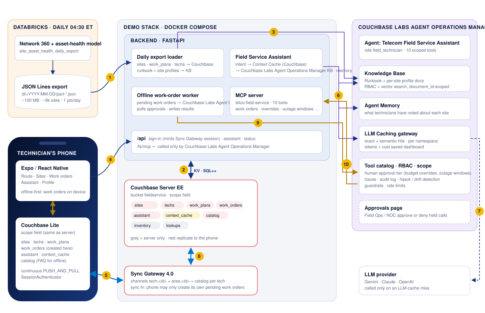
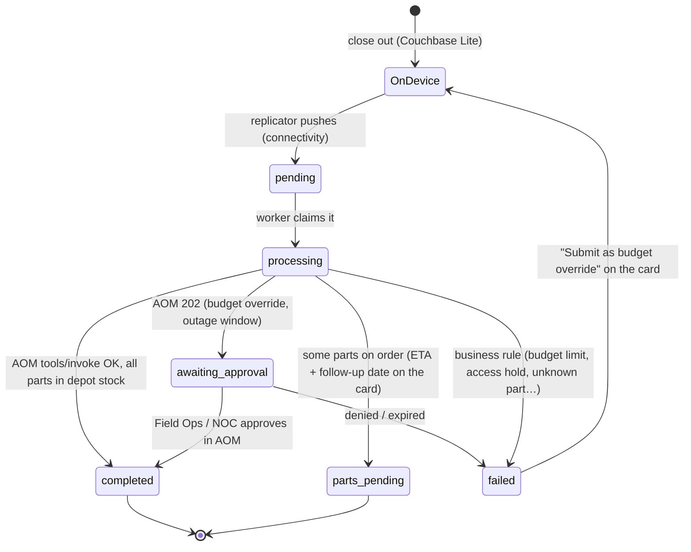

# Telecom Field Service on Couchbase

A field-service app for the technicians who keep a telecom network on air: macro towers, rooftop sites, small cells, central offices, fiber hubs and microwave relays. It covers both halves of the job in one work order:

* **Corrective maintenance** - the site has an open alarm (battery string conductance low, VSWR high, rectifier module failed). Find the fault, fit the part, clear the alarm.
* **Preventive maintenance** - the scheduled visit: the site type's checklist, plus the wear parts an asset-health model predicts are close to failure.

It keeps working **inside a steel equipment shelter with no signal** - and at a site that is off-air *because it is the thing being repaired* - because every site, its alarms, assets, access notes and this morning's work plan live on the phone in **Couchbase Lite**. Work orders are closed out offline and **sync back through Sync Gateway** the moment the technician has a connection.

The data comes from a **daily Databricks export** of the asset-health model, and that is the only Databricks compute the app ever uses. Every site read, work plan, parts lookup and assistant answer during the day is served from Couchbase (or Couchbase Lite), never from a SQL warehouse or a Model Serving endpoint. The story page counts the warehouse queries that didn't run.

The app's assistant is **registered with, and governed by, the Couchbase Agent Operations Manager (AOM)**:

* answers are grounded in AOM's **Knowledge Base** (the Field Maintenance Runbook and one profile document per site)
* it is registered as an AOM **RAG Application** (`telco-field-assistant`), so its queries, cache hits and cost savings show on AOM's *RAG Applications* page
* the context it builds for each site question is cached in AOM's **Context Cache** and in Couchbase, which syncs it to the phone
* LLM calls go through AOM's **LLM Caching** gateway
* every work order, budget override, outage window, recurring task, RMA and visit log runs as an RBAC-checked, traced and audited AOM tool call, with human approval for budget overrides (Field Ops) and outage windows (the NOC)

Built from the Staples field order capture demo (same architecture, new domain), which is in turn based on the Princess Cruises mobile RAG demo and [Fujio-Turner/mobile_field_service](https://github.com/Fujio-Turner/mobile_field_service): Expo / React Native, Couchbase Lite via `cbl-reactnative`, Sync Gateway session auth, and offline-first writes that sync when the radio comes back.

---

## How the demo opens

`https://<host>:5153/story` is **Maintenance That Doesn't Wait for Signal**, a seven-chapter story for the room before the live app. Use ←/→ to move between chapters, **N** for talking points and ☾ for dark mode:

1. **A day in the field.** Why technicians are offline so often: steel shelters, sites that are off-air, basement telecom rooms, mountaintop relays, cable vaults, rooftop plant rooms. It closes with Maya closing out a $1,897 corrective work order at Salem Harbor Tower that is $377.40 over the site's remaining budget.
2. **What the app needs.** Eight requirements: four for the phone, four for the AI and the data platform.
3. **The Databricks bill.** The per-request design (a warehouse query per screen, a Model Serving call per visit) next to the nightly-export design. Press **Transform the stack**, or **T**, and watch "warehouse queries per day" go from 144,000 to 1.
4. **Offline-first, step by step.** The same work order in two phones, one with Couchbase Lite and one online-only. Press **Next step**, or Space.
5. **One data plane for the AI.** Databricks to Couchbase to the AOM Knowledge Base, RAG app and caches, and on to the phone - with live numbers from the running backend.
6. **Where the Databricks money goes.** Per-request serving vs. nightly export + Couchbase, line by line.
7. **See it run.** Links to the app and the AOM dashboard, plus a ten-minute demo script.

## What the demo shows

| Concept | Where you see it |
|---|---|
| **The route and every site, on the phone** | *Route* lists today's stops with the SLA class, corrective/preventive, open alarms and a note on the signal at that site. *Sites* is the whole area, searchable offline. Opening a stop shows contacts, access notes, open alarms, asset health, outage risk, SLA and budget, work history and the model's briefing - all from Couchbase Lite. |
| **Work plan from Databricks** | Each site's `plan::<id>` document combines corrective tasks (from open alarms), the preventive checklist for the site type, and the asset-health model's recommended parts with days-to-failure, checked against on-hand units at the serving depot and the site's remaining maintenance budget. The Work order screen is pre-filled from it and re-ranks after every work order. |
| **Couchbase Lite: offline and online** | Turning on *Profile → No signal* pauses replication. You can still open any site, work the checklist, pick parts, close out the work order (saved as a `work_orders` document marked **On device**), and ask the assistant. Switch it off: the work order syncs and comes back **Completed** (or **Parts on order** with an ETA and a follow-up date). |
| **Budget override with human approval** | Salem Harbor Tower's plan exceeds what is left of its quarterly maintenance budget. A plain `submit_work_order` fails with `reason_code: budget_limit`; submitting it as `request_budget_override` is held by AOM as **Awaiting approval** until Field Ops approves it on AOM's Approvals page, after which the work order is closed, both alarms clear and the plan flips back to preventive. |
| **Outage window with NOC approval** | Service-affecting parts (radios, baseband cards, backhaul optics, RF jumpers) are flagged on the work order with the minutes off-air. `request_outage_window` is held by AOM until the NOC approves it. |
| **Access hold** | Fort Worth Stockyards Rooftop is on an access hold (landlord dispute). Work orders are refused with `site_hold`, overrides and windows can't release it, and the assistant steers to logging the visit as *no access*. |
| **Databricks offload** | `/api/status → metrics` counts every site 360, work plan, parts lookup and assistant context served from Couchbase instead of a warehouse query or a Model Serving call, and turns it into dollars. Chapter 5 of the story shows it live. |
| **Registered with AOM** | `scripts/register_with_aom.py` (or `AOM_AUTO_REGISTER` in Kubernetes) sets up the **Telecom Field Service Assistant** agent identity (role `field_technician`, scoped to 10 tools), the **`telco-field-service`** MCP server, the approval tier, and the **`telco-field-assistant` RAG Application**. |
| **AOM RAG Application** | Runbook questions ("How do I test a battery string?", "What are the rules for climbing a tower?") go to `POST /v1/agent/rag/telco-field-assistant/query`. The app is scoped to the one *Field Maintenance Runbook* document, so a generic question can never retrieve another area's site. |
| **Knowledge Base fed by the daily export** | The loader publishes the runbook plus one *Site profile* document per site due for a visit soon. The assistant always searches with a `document_id` filter, so a question about one tower can only be grounded in **that** site's profile. |
| **Context Caching** | For site questions the assistant assembles context (the site's KB profile chunks, runbook chunks and live tool facts: work plan, alarms, depot on-hand, budget) and caches it in **AOM's Context Cache** (namespace `rag:telco-field-assistant:site-context`, key `<site>:<intent>:<export_date>:r<site rev>`). The next export or any work order on the site changes the key, so the entry is never served stale. The same context is written to Couchbase as `ctx::<site>::<intent>`, which syncs to every technician in the area; that copy is what the offline assistant answers from. |
| **LLM Caching** | Runbook questions contain no site data, so the second technician to ask the same question gets `LLM cache · exact hit`. Site questions go through `/v1/llm/complete` in the `rag:telco-field-assistant:site` namespace. |

---

## Architecture



| # | Flow |
|---|---|
| **1** | Every morning the Databricks job drops a `dt=YYYY-MM-DD` JSON Lines partition, and the loader picks up the newest one with a `_SUCCESS` marker. Databricks is done for the day. |
| **2** | The loader upserts every site, builds the work plan for every site due for a visit soon, builds one route document per technician and publishes the parts catalog in Couchbase Server. The assistant reads and writes its **context cache** there, the worker reads pending work orders, and the MCP tools apply work orders, budget and visits. |
| **3** | The loader replaces the AOM **Knowledge Base** documents (the runbook and one profile per site due soon), then re-scopes the **RAG Application** to the new runbook. |
| **4** | Sign-in: the backend creates the technician's Sync Gateway user (channels `tech:<id>`, `area:<id>`, `catalog`) and mints a session. The assistant is called over `/api`. |
| **5** | **Couchbase Lite** replicates continuously with Sync Gateway. Every screen renders from the phone, and work orders become `work_orders` documents saved locally, even offline. |
| **6** | Runbook questions go to the assistant's **RAG Application** in one call. Site questions check AOM's **Context Cache**; on a miss the assistant does document-scoped **KB retrieval**, stores the context in AOM and Couchbase, recalls **memory**, then calls the **LLM Caching** gateway. |
| **7** | AOM calls the LLM provider only on a cache miss. |
| **8** | Sync Gateway carries work orders up and results back down: completions, parts on order, cleared alarms, the updated budget and the re-ranked plan. |
| **9** | The worker runs each work order as the **Telecom Field Service Assistant** agent through `POST /v1/tools/invoke`, so RBAC, tool scope, the approval tier, a trace and an audit entry are applied. |
| **10** | AOM calls the `telco-field-service` MCP server, which issues depot stock, closes the work order on the site and re-ranks its plan in Couchbase, and that syncs back to the phone (2 → 8 → 5). |

### Offline-first work order lifecycle



---

## Quick start

### 1. Browser preview in about 2 minutes (no Docker, no AOM)

The backend can run on an in-memory store, and the app has a browser preview engine that syncs the same documents over REST. Use this to look at the UX. Couchbase Lite needs a device build (step 3).

```bash
python3 databricks/generate_mock_dump.py            # ~100 MB export → data/databricks-dump/dt=<today>/
cd backend && python3 -m venv .venv && . .venv/bin/activate && pip install -r requirements.txt
uvicorn app.main:app --port 8200                    # STORE_DRIVER=memory by default
# new terminal
cd mobile && cp .env.example .env && sed -i '' 's/8203/8200/' .env && npm install && npx expo start --web
```

### 2. Full stack: Couchbase, Sync Gateway and AOM

You need Docker Desktop, and the Couchbase Agent Operations Manager running on the same machine at `https://localhost:8090`, with its admin password set.

```bash
cp .env.example .env
./scripts/setup-corporate-ca.sh            # only behind a TLS-inspecting proxy (Zscaler etc.)
python3 databricks/generate_mock_dump.py   # the export the backend loads
docker compose up -d --build               # couchbase, init, sync-gateway, sg-init, backend, web
docker compose logs -f backend             # wait for "Loaded export …: … sites"

python3 scripts/register_with_aom.py --admin-password '<AOM admin password>'
docker compose up -d --build backend       # picks up AOM_* from .env, publishes the KB, scopes the RAG app
```

Then open **https://localhost:5153/story** for the story, **https://localhost:5153** for the app in a browser, or **http://localhost:8203** for a page linking every service.

| Port | Service |
|---|---|
| `5153` | **The app in a browser** over HTTPS, behind the sign-in page (`web` service), shown inside a phone frame (add `?frame=0` for full width) |
| `8203` | Backend API + MCP server (`/fs/mcp`); `/` lists every link |
| `4990` | Sync Gateway public, which is what phones replicate with: `ws://<host>:4990/fieldservice` |
| `127.0.0.1:4991` | Sync Gateway admin |
| `127.0.0.1:18094` | Couchbase Web Console (Administrator / password123) |

**Sign-in and HTTPS.** The browser UI (the app, the story page and everything else the `web` container serves) is on **`https://<host>:5153`** and opens on a sign-in page:

| Username | Password |
|---|---|
| `demo` | `Couchbase123!` |

Change them with `DEMO_USERNAME` / `DEMO_PASSWORD` in `.env` (Compose) or `web.auth.username` / `web.auth.password` (Helm). The container serves a self-signed certificate it generates on first start, so the browser warns once; add the address people use to `TLS_HOSTS` (Compose) so it is in the certificate, or serve a real one by mounting `tls.crt` / `tls.key` at `/etc/nginx/tls` (Helm: `web.tls.secretName`). Plain `http://` on the same port redirects to HTTPS, and `/signout` ends the session. The sign-in covers the browser UI only: the backend API and Sync Gateway ports are unchanged.

Ports are one above the Staples demo's (8083 / 8202 / 4988 / 4989 / 18093), so both stacks can run side by side next to AOM and the cruise demos. Bucket and Sync Gateway database are `fieldservice`; container names start with `fs-`.

### 3. The app on a device with Couchbase Lite

Couchbase Lite is a native module, so it needs a **development build**; Expo Go can't load it. `npm install` runs `scripts/fetch-cbl-native.sh`, which fetches the `cbl-reactnative` native submodules that npm skips.

```bash
cd mobile
cp .env.example .env                       # API + Sync Gateway URLs (LAN IP for a physical phone)
npm install
npx expo run:ios -d "iPhone 16 Pro"        # or: npx expo run:android
```

The `web` service serves a prebuilt browser bundle (`web/dist.tgz`). After changing the app, rebuild it with `cd mobile && npm run export:web:docker`, then `docker compose up -d --build web`.

### 4. Kubernetes with Helm (K3s / Rancher)

`deploy/k8s/deploy.sh` deploys AOM (**agent-ops**) and this demo (**fieldservice-app**) onto a single-node K3s cluster without a container registry:

```bash
AOM_ADMIN_PASSWORD='<current AOM password>' ONLY=fieldservice ./deploy/k8s/deploy.sh              # mother
AOM_ADMIN_PASSWORD='<current AOM password>' TARGET=hal ONLY=fieldservice ./deploy/k8s/deploy.sh   # hal
```

`deploy/k8s/values-mother.yaml` and `values-hal.yaml` publish it on **5153 / 8203 / 4990**. With `AOM_AUTO_REGISTER=true` the backend registers itself with AOM (MCP server, agent, approval tier, Knowledge Base and RAG application); progress is in `/api/status` under `aom.registration`. A daily CronJob (04:30 America/New_York) drops a new mock export and the backend picks it up within five minutes.

---

## Demo script (about 10 minutes)

1. **Maya Chen** (employee **204817** / **Chen**, Boston North Shore, 5 stops)
   * *Route*: Salem Harbor Tower first, 8:30, Critical SLA, **Corrective**, 2 alarms, "Steel equipment shelter - no signal inside". Open it: landlord and NOC contacts, door code note, the two alarms, asset health with *Battery string A* in the red, 62% outage risk, **$1,519.60 of budget left**, work history, the briefing.
   * *Profile → No signal* **on**. Back to the tower → **Start work order**: 2 corrective tasks, a 6-step preventive checklist, 6 parts pre-filled from the model, battery blocks flagged "fails in ~1d" and "Only 3 on hand - 1 will go on order", total **$1,897.00 - $377.40 over the remaining budget**, computed on the phone. Tick the tasks, **Submit as budget override** → **On device**. Ask the assistant "What needs doing at this site today?" → **Answered on device · Couchbase Lite**.
   * Switch *No signal* **off**: the work order syncs, AOM holds it → **Awaiting approval**. Approve it in AOM → *Approvals*; the card flips to **Parts on order** (one battery block short at the Northeast depot - the ETA is on the card), both alarms clear, the budget and history update, and the plan no longer lists what was just fitted. In AOM, show the trace and audit entry for `telco-field-service::request_budget_override`.
   * *Salem Central Office*: fit rectifier modules ×2 → **Parts on order**. Ask "How does a budget override work?" twice: `Context cache · hit` and `LLM cache · exact hit`. Open **sources**: the runbook.
2. **Devon Walker** (**318552** / **Walker**, Hudson Valley): asks the same runbook question and gets an **LLM cache exact hit** from Maya's turn, because the runbook namespace is shared and has no site data. At Catskill Ridge Microwave Relay ask "Do I need an outage window for this work?" and request one; the NOC approves it in AOM. Set a recurring air-filter change at Rhinebeck Central Office.
3. **Sofia Alvarez** (**427190** / **Alvarez**, Dallas-Fort Worth): three Lone Star Stadium District small cells on one Hub SLA. Fort Worth Stockyards Rooftop is on an **access hold**: the work order is refused with `site_hold` and the assistant steers to logging *no access*. Log a visit at Plano Central Office; the stop flips to visited on the route.
4. Finish on **story chapter 5**: the counters moved because of what you just did, and every one is a Databricks query that didn't run.

---

## The Databricks export

`databricks/generate_mock_dump.py` writes the exact layout the Databricks notebook produces: Spark JSON Lines part files, `_SUCCESS`, and a `_manifest.json`.

```bash
python3 databricks/generate_mock_dump.py --export-date 2026-11-13 --target-mb 100 --parts 4
```

* **About 12,000 network sites** across ~200 areas (one technician each), 100 MiB, deterministic for a given `--seed` on a given Python version.
* One line is **one site**: identity and site code, site type, cluster, address, area and assigned technician, contacts, SLA class, maintenance budget and access hold (`auth`), access profile and serving depot, visit cadence with a note on the signal at the site, installed `assets` with a health score, open `alarms`, 30-day `kpis`, the last work orders with parts, `wear` per part, 12-month maintenance spend, recurring tasks, and **`ml_scores`** from `telco-asset-health-v2.3`.
* `ml_scores` holds the failure risk per equipment category, 30-day outage risk, days-to-failure per component, the recommended parts with a confidence each, upgrade candidates, segment and next best action.
* Three hand-built **demo technicians** and their stops, with `next_visit_date` pinned to the export date, are always the first rows.
* `databricks/notebooks/site_asset_health_daily_export.py` is the production equivalent: Network 360 joins, the fault-management alarm feed, MLflow model scoring, a Delta table, and the JSON export to a Unity Catalog volume. `databricks/jobs/…job.json` schedules it daily at 04:30 America/New_York.

---

## Data model

Bucket `fieldservice`, scope `field`. Sync Gateway replicates the first seven collections to Couchbase Lite (same scope and collection names on the phone). A technician's SG user gets the `tech:<id>`, `area:<id>` and `catalog` channels.

| Collection | Document | Channel | Written by | Notes |
|---|---|---|---|---|
| `sites` | `site::<id>` | area | loader, actions | The export row + `rev` (bumped on every work order, budget change, recurring task, outage window, visit) |
| `techs` | `tech::<id>` | tech | loader, actions | Area, today's route (stops in order, visited flags), totals |
| `work_plans` | `plan::<site>` | area | personalization | Corrective + preventive tasks, recommended parts with depot on-hand, budget check, briefing |
| `work_orders` | `wo::<tech>::<uuid>` | tech | **the phone** (create), worker (status) | Offline-first queue for every field action. The sync function allows `requireUser(tech_id)`, `status: pending` and creation only |
| `assistant` | `chat::<tech>` | tech | assistant | History + answers reusable offline (keyed by site + question) |
| `context_cache` | `ctx::<site>::<intent>`, `ctx::<tech>::runbook_<intent>` | area / tech | assistant | Phone copy of the **Context Cache** entry also held in AOM |
| `catalog` | `catalog::v1` | catalog | loader | Spare parts, SLA classes, work types, PM checklists per site type, depots, FAQ |
| `inventory` | `inv::<depot>` | — | actions | On-hand units per part per spares depot (CAS updates). Server only |
| `lookups` | `login::…`, `kbdoc::…`, `load_state` | — | loader | Login index, KB document ids, load status. Server only |

The tools on the `telco-field-service` MCP server are `get_site_context`, `get_work_plan`, `search_parts`, `quote_work_order`, `submit_work_order`, `request_budget_override` (approval required), `set_recurring_task`, `create_rma`, `log_site_visit` and `request_outage_window` (approval required). Every tool takes the calling `tech_id`, and a site can only be worked by a technician whose area it belongs to.

---

## Configuration

Backend variables go in `.env` (see `.env.example`); `docker-compose.yml` sets the infrastructure ones.

| Variable | Default | |
|---|---|---|
| `STORE_DRIVER` | `memory` (compose: `couchbase`) | `memory` keeps sites due for a visit within `MEMORY_WINDOW_DAYS`, plus the demo areas |
| `AOM_URL`, `AOM_AGENT_API_KEY` | — | Agent identity, written by `register_with_aom.py` |
| `AOM_ADMIN_USERNAME`, `AOM_ADMIN_PASSWORD` | — | Used only to publish KB documents |
| `KB_WINDOW_DAYS`, `KB_PROFILE_LIMIT` | `7`, `150` | Which sites get a KB profile each day |
| `CONTEXT_CACHE_TTL_SECONDS` | `21600` | Upper bound; the export date and site rev invalidate it sooner |
| `RAG_APP_ID` | `telco-field-assistant` | AOM RAG Application id; `RAG_APP_ENABLED=false` skips it |
| `DBX_COST_PER_QUERY_USD` | `0.035` | Illustrative cost per warehouse / Model Serving call behind the story's "spend avoided" counter |
| `DEMO_TODAY` | export's `export_date` | Keeps "today's route" stable whenever you demo |
| `SG_PUBLIC_URL` | — | Replication URL handed to phones |

App variables (`mobile/.env`): `EXPO_PUBLIC_API_URL`, `EXPO_PUBLIC_SG_URL`, `EXPO_PUBLIC_DB_ENGINE` (`auto` · `cbl` · `preview`).

---

## Tests

```bash
cd backend && pytest -q          # 18 tests
cd mobile && npm run typecheck
```

`test_demo_flows.py` covers the route and area sync, work plans (corrective first, then the checklist), the budget-limit failure and the override that closes the work order and clears the alarms, short depot stock as parts on order, the assistant's context cache and runbook answers, access holds, outage windows, area authorization, recurring tasks, visit logs, RMAs, push authorization and the Databricks offload counters. `test_aom_integration.py` runs the backend against `tests/fake_aom.py`, which has the same routes and shapes as AOM. `test_aom_bootstrap.py` starts the backend with `AOM_AUTO_REGISTER` against a fresh fake AOM.

---

## Repository layout

```
backend/            FastAPI API, MCP server, loader, worker, assistant (Python)
  app/catalog.py        spare parts, site types and PM checklists, SLA classes, depots, areas (shared with the generator)
  app/personalization.py  the work plan per site: corrective tasks, checklist, recommended parts
  app/actions.py        work order / budget / outage window / recurring task / RMA / visit logic behind every tool
  app/assistant.py      intent → AOM RAG app (runbook) | AOM Context Cache → KB + memory + LLM cache (site) → actions
  app/knowledge.py      the Field Maintenance Runbook and site profile documents
  app/loader.py         daily export → Couchbase (sites, work plans, routes) + AOM Knowledge Base
  app/worker.py         offline-first work orders → AOM tools/invoke
mobile/             Expo app (Couchbase Lite engine + browser preview engine)
databricks/         mock export generator, PySpark notebook, daily job
couchbase-init/     bucket / scope / collections / indexes
sync-gateway/       bootstrap + database config with per-collection sync functions
scripts/            register_with_aom.py, setup-corporate-ca.sh
web/                nginx image serving the browser build of the app and the story page
helm/fieldservice-app/   Helm chart for the demo
deploy/k8s/         deploy.sh + values for the K3s nodes
docs/images/        architecture diagram and the Couchbase logo files
```

## Notes

* **Brand.** The palette is Couchbase red (`#EA2328`) on white with the brand's near-black for dark surfaces. `docs/images/couchbase-logo.svg` is the logo file from Couchbase's own `couchbase/docs-ui` repository, unmodified; the reversed (white wordmark) and mark-only variants and the PNGs in `mobile/assets/images` are generated from it. The operator, sites, technicians, part numbers, costs, alarms and policies are fictional demo data, and vendors are deliberately generic.
* **Databricks numbers.** The offload counters are a demo instrument: they count reads the app served from Couchbase that a per-request design would have sent to a SQL warehouse or Model Serving endpoint, at a flat `DBX_COST_PER_QUERY_USD`. Replace the rate with the customer's blended per-query cost before quoting a figure.
* **Runbook content.** The procedures in `backend/app/knowledge.py` (battery testing, VSWR, tower climbing, outage windows) are plausible illustrations for a demo, not an operator's method of procedure or a safety standard.
* **Couchbase licensing.** Couchbase Server EE and Sync Gateway EE images run under the free developer license for dev and test. Shipping Couchbase Lite with encryption requires an Enterprise license.
